# Project 9: Neural-Network Capacity and Generalization
## Complete Technical Research Report

**Course / Project:** University Machine Learning Research Project — Project 9  
**Team Structure:** Six-Member Collaborative Research Team (Workstreams M1–M6)  
**Repository Root:** `d:\Neural Network Capacity and Generalization`  
**Date:** November 11, 2026  

---

## 1. Title Page

**Title:** *Neural-Network Capacity and Generalization: Separating Representation Learning, Overfitting, Memorization, and Optimization Failure in One-Hidden-Layer Neural Networks*

**Team Workstream Attribution:**
- **Member 1 (Mathematical Foundations & Backpropagation):** Architecture formalization, matrix-calculus derivations, pure-NumPy & PyTorch MLPs, finite-difference verification (`E1`).
- **Member 2 (Dataset Engineering & Baselines):** Synthetic nonlinear generator, UCI Concrete acquisition and leakage-free preprocessing, OLS linear baseline (`E2`).
- **Member 3 (Capacity & Training-Size Experiments):** Hidden-layer width sweep (`E3`), training-set size scaling (`E4`), multi-seed variance aggregation.
- **Member 4 (Regularization & Randomized Labels):** Unregularized vs. coupled L2 vs. decoupled AdamW vs. early stopping (`E5`), randomized-target memorization (`E6`).
- **Member 5 (Optimization & Computational Analysis):** Protocol A/B compute-budget evaluations (`E7`), controlled failure-mode diagnostic interventions (`E8`).
- **Member 6 (Integration, Reporting & Presentation):** Unified pipeline orchestrator, automated result tables and 23 publication figures, technical report, presentation deck, and Phase 12 reproducibility audit.

---

## 2. Abstract

A central challenge in machine learning is distinguishing genuine population generalization from finite-sample memorization, variance-driven overfitting, optimization failure, and structural underfitting. This study investigates these phenomena systematically using a from-scratch, double-precision (`float64`) NumPy one-hidden-layer multilayer perceptron (MLP) evaluated across a controlled 1D nonlinear regression task ($f^*(x) = 2\sin(2x) + 0.5x^2 + \varepsilon$, irreducible Bayes MSE $\sigma^2 = 0.1225$) and the 8-dimensional UCI Concrete Compressive Strength benchmark ($N = 1030$, target in MPa). Analytical backpropagation gradients are verified against central finite differences ($\le 1.86 \times 10^{-10}$ relative error) and PyTorch autograd ($\le 2.25 \times 10^{-16}$ relative error).

Across eight controlled experiments (`E1`–`E8`), we establish five principal empirical findings:
1. **Capacity vs. Generalization:** Linear Ordinary Least Squares (OLS) fails severely on synthetic ($R^2 = 0.0238$) and plateaus at $R^2 = 0.5752$ ($\text{RMSE} = 10.59\text{ MPa}$) on Concrete. On Concrete ($N_{\text{train}} = 618$), increasing width $H$ yields a validation minimum at $H=16$ ($P=161$, test $R^2 = 0.8733$), followed by a sharp generalization-gap peak at $H=64$ ($P=641 \approx N_{\text{train}}$, validation MSE $44.54 \pm 12.10\text{ MPa}^2$) and partial variance descent at $H=256$ ($36.44\text{ MPa}^2$).
2. **Sample-Size Scaling:** Holding $H=32$ fixed, growing $N$ monotonically shrinks variance and closes the generalization gap from $0.2445 \to 0.0027\text{ units}^2$ on synthetic ($N=25 \to 800$) and $168.25 \to 30.95\text{ MPa}^2$ on Concrete ($N=25 \to 618$).
3. **Regularization:** On over-parameterized $H=128$ Concrete networks, unregularized training suffers severe overfitting (test MSE $48.24\text{ MPa}^2$, $R^2 = 0.8173$), whereas validation-selected early stopping (test MSE $30.56\text{ MPa}^2$, $\text{RMSE}=5.53\text{ MPa}$, $R^2 = 0.8842$) and coupled L2 ($\lambda=0.001$, test MSE $30.47\text{ MPa}^2$, $R^2 = 0.8846$) eliminate variance inflation.
4. **Memorization vs. Generalization:** Independently permuting training targets in Concrete reveals a sharp capacity threshold: $H=4$ ($P=41 < N=100$) fails to memorize ($96.70\text{ MPa}^2$), while $H \ge 16$ achieves $100\%$ memorization ($0.28\text{–}0.68\text{ MPa}^2$ train MSE) alongside catastrophic validation collapse ($1881\text{–}2434\text{ MPa}^2$). On 1D synthetic data, standard Xavier initialization ($b_1=0$) exhibits implicit low-frequency spectral bias that resists random noise until bias-threshold symmetry is explicitly broken.
5. **Compute Fairness & Diagnostics:** Normalizing for total FLOPs reverses width rankings compared to fixed-step evaluations, and controlled interventions cleanly isolate optimization failures, overfitting, and inadequate representation.

---

## 3. Introduction and Motivation

Achieving low training error on historical data is never sufficient to guarantee predictive accuracy on unseen observations. A practitioner confronting poor validation performance faces fundamentally different remedies depending on the underlying cause: tuning learning rates or optimizers cures **optimization failure**, collecting more data or adding weight decay/early stopping cures **overfitting**, whereas expanding architecture width or adding nonlinearities cures **inadequate representation**. Applying the wrong intervention—such as increasing capacity when the model is already overfitting, or adding L2 regularization when the model is under-optimized—wastes compute and degrades generalization.

One-hidden-layer neural networks offer an ideal scientific testbed for isolating these mechanisms. They are universal function approximators whose exact parameter count $P(d, H) = H(d+2)+1$ is transparent, whose exact matrix-calculus gradients can be derived analytically and verified elementwise, and whose training dynamics exhibit classical bias–variance tradeoffs, interpolation-threshold variance spikes, implicit spectral bias, and capacity-driven memorization of arbitrary targets.

---

## 4. Problem Statement and Central Research Questions

We evaluate one-hidden-layer regression MLPs under strict train/validation/test isolation to answer ten empirical questions:

1. **Q1:** How does neural-network hidden-layer width $H$ affect capacity and generalization?
2. **Q2:** How does training-set size $N$ influence generalization and variance?
3. **Q3:** Can a one-hidden-layer neural network memorize independently randomized targets?
4. **Q4:** Does greater model capacity always improve test performance?
5. **Q5:** How effective are weight decay (coupled L2 and decoupled AdamW) and early stopping?
6. **Q6:** How does neural-network performance compare with an OLS linear regression baseline?
7. **Q7:** Can optimization failure be distinguished experimentally from overfitting and underfitting?
8. **Q8:** How do fixed-step vs. matched-FLOP computational constraints alter model comparisons?
9. **Q9:** Do conclusions from the controlled synthetic task hold on the real-world Concrete dataset?
10. **Q10:** What are the scope boundaries and methodological limitations of these experiments?

---

## 5. Mathematical Background

### 5.1 Probabilistic Observation Model and Equivalence to MSE
In regression, we model scalar observations $y \in \mathbb{R}$ conditioned on feature vector $x \in \mathbb{R}^d$ under a Gaussian noise model with fixed homoscedastic variance $\sigma_y^2 > 0$ and mean predicted by the network $\hat{y}(x; \theta)$:
$$p(y \mid x; \theta) = \mathcal{N}\!\left(y \;\middle|\; \hat{y}(x; \theta), \sigma_y^2\right) = \frac{1}{\sqrt{2\pi\sigma_y^2}} \exp\!\left(-\frac{\big(y - \hat{y}(x; \theta)\big)^2}{2\sigma_y^2}\right)$$

For a mini-batch $\{(x_i, y_i)\}_{i=1}^B$ assumed conditionally i.i.d., maximizing the conditional log-likelihood $\ell(\theta) = \sum_{i=1}^B \log p(y_i \mid x_i; \theta)$ is equivalent to minimizing the negative log-likelihood:
$$-\ell(\theta) = \frac{B}{2}\log(2\pi\sigma_y^2) + \frac{1}{2\sigma_y^2} \sum_{i=1}^B (\hat{y}_i - y_i)^2 = \text{const} + \frac{B}{2\sigma_y^2} \cdot \mathcal{L}_{\text{MSE}}(\theta)$$
where
$$\mathcal{L}_{\text{MSE}}(\theta) = \frac{1}{B} \sum_{i=1}^B (\hat{y}_i - y_i)^2$$
Because $\frac{B}{2\sigma_y^2} > 0$ does not depend on $\theta$, Maximum Likelihood Estimation (MLE) is algebraically identical to minimizing $\mathcal{L}_{\text{MSE}}(\theta)$. Using the exact $1/B$ mean matches `torch.nn.MSELoss(reduction='mean')` and aligns optimization loss directly with reported MSE metrics.

### 5.2 Bias–Variance–Noise Decomposition
Under squared error, for any predictor $\hat{f}_{\mathcal{D}}(x)$ trained on random sample $\mathcal{D}$ where $y = f^*(x) + \varepsilon$ with $\mathbb{E}[\varepsilon]=0$ and $\operatorname{Var}(\varepsilon) = \sigma^2$:
$$\mathbb{E}_{\mathcal{D}, \varepsilon}\!\left[(y - \hat{f}_{\mathcal{D}}(x))^2\right] = \underbrace{\big(\mathbb{E}_{\mathcal{D}}[\hat{f}_{\mathcal{D}}(x)] - f^*(x)\big)^2}_{\text{Bias}^2} + \underbrace{\mathbb{E}_{\mathcal{D}}\!\left[\big(\hat{f}_{\mathcal{D}}(x) - \mathbb{E}_{\mathcal{D}}[\hat{f}_{\mathcal{D}}(x)]\big)^2\right]}_{\text{Variance}} + \underbrace{\sigma^2}_{\text{Irreducible Noise}}$$
Hence, $\sigma^2$ bounds the lowest achievable expected test MSE. Any training MSE dropping below $\sigma^2$ indicates fitting finite-sample noise.

---

## 6. Neural Network Architecture

All neural experiments use a fully connected one-hidden-layer architecture (`Input -> Hidden Layer -> Activation -> Output Layer`):
$$z_1 = W_1 x + b_1, \qquad h = \phi(z_1), \qquad \hat{y} = W_2 h + b_2$$
with single-sample shapes $x \in \mathbb{R}^d$, $W_1 \in \mathbb{R}^{H \times d}$, $b_1 \in \mathbb{R}^H$, $h \in \mathbb{R}^H$, $W_2 \in \mathbb{R}^{1 \times H}$, and $b_2 \in \mathbb{R}^1$. Total trainable parameter count is:
$$P(d, H) = Hd + H + H + 1 = H(d + 2) + 1$$
On the 1D synthetic task ($d=1$), $P(1, H) = 3H + 1$ (ranging from $13$ at $H=4$ to $769$ at $H=256$). On UCI Concrete ($d=8$), $P(8, H) = 10H + 1$ (ranging from $41$ at $H=4$ to $2561$ at $H=256$).

### Activation Choice: `tanh` vs. `ReLU`
We implement and verify both:
- **Hyperbolic tangent:** $\phi(z) = \tanh(z)$, smooth $C^\infty$ everywhere, zero-centered outputs in $(-1, 1)$, and derivative $\phi'(z) = 1 - \tanh^2(z) = 1 - h^2$. Initialized with Glorot/Xavier uniform weights $W_1 \sim \mathcal{U}[-\sqrt{6/(d+H)}, \sqrt{6/(d+H)}]$, $b_1 = 0$.
- **Rectified Linear Unit:** $\phi(z) = \max(0, z)$, piecewise linear with subgradient $\phi'(z) = \mathbb{I}[z > 0]$ and nondifferentiable kink at $z = 0$. Initialized with He normal weights $W_1 \sim \mathcal{N}(0, 2/d)$, $b_1 = 0$.

In pilot Experiment `E2` ($H=32$), `tanh` achieved lower test MSE and higher test $R^2$ than `ReLU` on both synthetic ($R^2 = 0.9580$ vs. $0.9415$) and Concrete ($R^2 = 0.8575$ vs. $0.8410$) while producing smooth continuous interpolants without piecewise-linear corners. We therefore select **`tanh`** as the primary controlled activation and retain **`ReLU`** for gradient-verification kink tests and diagnostic comparisons.

---

## 7. Forward Propagation and Backpropagation Derivation

Let rows of $X \in \mathbb{R}^{B \times d}$ denote $B$ training observations, with targets $Y \in \mathbb{R}^{B \times 1}$.

### 7.1 Vectorized Forward Propagation
$$\begin{aligned}
Z_1 &= X W_1^\top + \mathbf{1}_B b_1^\top &&\in \mathbb{R}^{B \times H} \\
A_1 &= \phi(Z_1) &&\in \mathbb{R}^{B \times H} \\
\hat{Y} &= A_1 W_2^\top + \mathbf{1}_B b_2^\top &&\in \mathbb{R}^{B \times 1}
\end{aligned}$$
where $b_1^\top \in \mathbb{R}^{1 \times H}$, $b_2^\top \in \mathbb{R}^{1 \times 1}$, and $\mathbf{1}_B \in \mathbb{R}^B$ is the column vector of ones. The regularized objective is:
$$J(\theta) = \underbrace{\frac{1}{B} \sum_{i=1}^B (\hat{Y}_i - Y_i)^2}_{\mathcal{L}_{\text{MSE}}} + \frac{\lambda}{2}\left(\|W_1\|_F^2 + \|W_2\|_F^2\right)$$

### 7.2 Output-Layer Gradients
Differentiating $\mathcal{L}_{\text{MSE}}$ with respect to network outputs $\hat{Y}$ defines the output error signal $\delta_{\text{out}} \in \mathbb{R}^{B \times 1}$:
$$\delta_{\text{out}} \equiv \frac{\partial \mathcal{L}_{\text{MSE}}}{\partial \hat{Y}} = \frac{2}{B}(\hat{Y} - Y) \in \mathbb{R}^{B \times 1}$$
Applying the chain rule through $\hat{Y} = A_1 W_2^\top + \mathbf{1}_B b_2^\top$:
$$\frac{\partial \mathcal{L}_{\text{MSE}}}{\partial W_2} = \delta_{\text{out}}^\top A_1 \in \mathbb{R}^{1 \times H}, \qquad \frac{\partial \mathcal{L}_{\text{MSE}}}{\partial b_2} = \sum_{i=1}^B (\delta_{\text{out}})_i = \mathbf{1}_B^\top \delta_{\text{out}} \in \mathbb{R}^{1 \times 1}$$

### 7.3 Hidden-Layer Gradients
Propagating the error signal backward through $W_2$ and the elementwise activation Jacobian $\phi'(Z_1)$ defines $\delta_1 \in \mathbb{R}^{B \times H}$:
$$\frac{\partial \mathcal{L}_{\text{MSE}}}{\partial A_1} = \delta_{\text{out}} W_2 \in \mathbb{R}^{B \times H}, \qquad \delta_1 \equiv \frac{\partial \mathcal{L}_{\text{MSE}}}{\partial Z_1} = \left(\delta_{\text{out}} W_2\right) \odot \phi'(Z_1) \in \mathbb{R}^{B \times H}$$
where $\odot$ denotes the Hadamard (elementwise) product.

### 7.4 Input-Layer Weight and Bias Gradients
Applying the chain rule through $Z_1 = X W_1^\top + \mathbf{1}_B b_1^\top$:
$$\frac{\partial \mathcal{L}_{\text{MSE}}}{\partial W_1} = \delta_1^\top X \in \mathbb{R}^{H \times d}, \qquad \frac{\partial \mathcal{L}_{\text{MSE}}}{\partial b_1} = \mathbf{1}_B^\top \delta_1 \in \mathbb{R}^{1 \times H}$$

### 7.5 Weight-Decay Regularization and Optimizer Updates
**Coupled L2 Penalty (Weights Only):** Differentiating $\frac{\lambda}{2}\left(\|W_1\|_F^2 + \|W_2\|_F^2\right)$ yields:
$$\nabla_{W_k} J = \nabla_{W_k} \mathcal{L}_{\text{MSE}} + \lambda W_k, \qquad \nabla_{b_k} J = \nabla_{b_k} \mathcal{L}_{\text{MSE}} \quad (k \in \{1, 2\})$$
Biases are excluded by default so the penalty regularizes model slope/curvature without shrinking the target offset toward zero (verified in Experiment `E5`).

**Optimizer Updates (`src/training/optimizers.py`):**
- **GD:** $\theta_{t+1} = \theta_t - \eta g_t$.
- **Momentum SGD:** $v_{t+1} = \mu v_t + g_t$, $\theta_{t+1} = \theta_t - \eta v_{t+1}$ ($\mu = 0.9$).
- **Adam (Coupled L2):** Using $g_t = \nabla_\theta J(\theta_t)$ (which includes $\lambda W_t$), $m_t = \beta_1 m_{t-1} + (1-\beta_1)g_t$, $v_t = \beta_2 v_{t-1} + (1-\beta_2)g_t^2$, bias-corrected $\hat{m}_t = m_t/(1-\beta_1^t)$, $\hat{v}_t = v_t/(1-\beta_2^t)$, $\theta_{t+1} = \theta_t - \eta \hat{m}_t / (\sqrt{\hat{v}_t} + \epsilon)$. Notice the L2 penalty $\lambda W_t$ is rescaled by $1/\sqrt{\hat{v}_t}$, weakening decay on weights with high historical gradient variance.
- **AdamW (Decoupled Weight Decay):** Computes $\hat{m}_t, \hat{v}_t$ solely from unregularized $\nabla_\theta \mathcal{L}_{\text{MSE}}$, then applies uniform relative shrinkage directly to weights: $W_{t+1} = (1 - \eta \lambda_{\text{dec}})W_t - \eta \hat{m}_t / (\sqrt{\hat{v}_t} + \epsilon)$.

---

## 8. Gradient Verification

In [gradient_check.py](file:///d:/Neural%20Network%20Capacity%20and%20Generalization/src/experiments/gradient_check.py), we verified every scalar parameter of `NeuralNetworkNumPy` on a fixed network ($d=3, H=4, B=8$, `float64`) against:
1. **Central Finite Differences** ($\epsilon = 10^{-6}$): $g_{\text{num}, k} = \frac{J(\theta + \epsilon e_k) - J(\theta - \epsilon e_k)}{2\epsilon}$, which achieves $\mathcal{O}(\epsilon^2)$ truncation error ($\sim 10^{-12}$) while avoiding float64 cancellation noise ($\sim 10^{-16}/\epsilon \approx 10^{-10}$). For `ReLU`, inputs are verified to satisfy $\min_{i,j} |Z_{1,ij}| > 10^{-3}$ so perturbations $\pm \epsilon$ never cross the nondifferentiable kink at zero.
2. **PyTorch Autograd** (`NeuralNetworkTorch`, `torch.float64`).

Relative error is defined as $\text{rel\_err}(a, b) = \|a - b\|_2 / \max(\|a\|_2 + \|b\|_2, 10^{-12})$.

| Activation | $\lambda$ | Param | Shape | Max Abs Error (FD) | Rel Error (FD) | Rel Error (PyTorch) | Status |
| :--- | :---: | :---: | :---: | :---: | :---: | :---: | :---: |
| `tanh` | 0.00 | `W1` | `[4, 3]` | $1.07 \times 10^{-10}$ | $1.19 \times 10^{-10}$ | $5.60 \times 10^{-17}$ | PASS |
| `tanh` | 0.00 | `b1` | `[1, 4]` | $4.75 \times 10^{-11}$ | $5.58 \times 10^{-11}$ | $4.99 \times 10^{-18}$ | PASS |
| `tanh` | 0.00 | `W2` | `[1, 4]` | $1.08 \times 10^{-10}$ | $1.17 \times 10^{-10}$ | $1.19 \times 10^{-16}$ | PASS |
| `tanh` | 0.00 | `b2` | `[1, 1]` | $6.33 \times 10^{-11}$ | $4.92 \times 10^{-11}$ | $1.73 \times 10^{-16}$ | PASS |
| `tanh` | 0.01 | `W1` | `[4, 3]` | $1.55 \times 10^{-10}$ | $1.43 \times 10^{-10}$ | $5.54 \times 10^{-17}$ | PASS |
| `tanh` | 0.01 | `b1` | `[1, 4]` | $4.75 \times 10^{-11}$ | $5.58 \times 10^{-11}$ | $4.99 \times 10^{-18}$ | PASS |
| `tanh` | 0.01 | `W2` | `[1, 4]` | $1.05 \times 10^{-10}$ | $1.40 \times 10^{-10}$ | $1.17 \times 10^{-16}$ | PASS |
| `tanh` | 0.01 | `b2` | `[1, 1]` | $6.33 \times 10^{-11}$ | $4.92 \times 10^{-11}$ | $1.73 \times 10^{-16}$ | PASS |
| `relu` | 0.00 | `W1` | `[4, 3]` | $4.62 \times 10^{-10}$ | $1.80 \times 10^{-10}$ | $8.59 \times 10^{-17}$ | PASS |
| `relu` | 0.00 | `b1` | `[1, 4]` | $3.81 \times 10^{-10}$ | $1.78 \times 10^{-10}$ | $4.75 \times 10^{-17}$ | PASS |
| `relu` | 0.00 | `W2` | `[1, 4]` | $5.24 \times 10^{-10}$ | $4.74 \times 10^{-11}$ | $6.71 \times 10^{-17}$ | PASS |
| `relu` | 0.00 | `b2` | `[1, 1]` | $6.52 \times 10^{-11}$ | $8.79 \times 10^{-11}$ | $2.25 \times 10^{-16}$ | PASS |
| `relu` | 0.01 | `W1` | `[4, 3]` | $4.68 \times 10^{-10}$ | $1.86 \times 10^{-10}$ | $8.52 \times 10^{-17}$ | PASS |
| `relu` | 0.01 | `b1` | `[1, 4]` | $3.81 \times 10^{-10}$ | $1.78 \times 10^{-10}$ | $4.75 \times 10^{-17}$ | PASS |
| `relu` | 0.01 | `W2` | `[1, 4]` | $4.19 \times 10^{-10}$ | $3.67 \times 10^{-11}$ | $6.70 \times 10^{-17}$ | PASS |
| `relu` | 0.01 | `b2` | `[1, 1]` | $6.52 \times 10^{-11}$ | $8.79 \times 10^{-11}$ | $2.25 \times 10^{-16}$ | PASS |

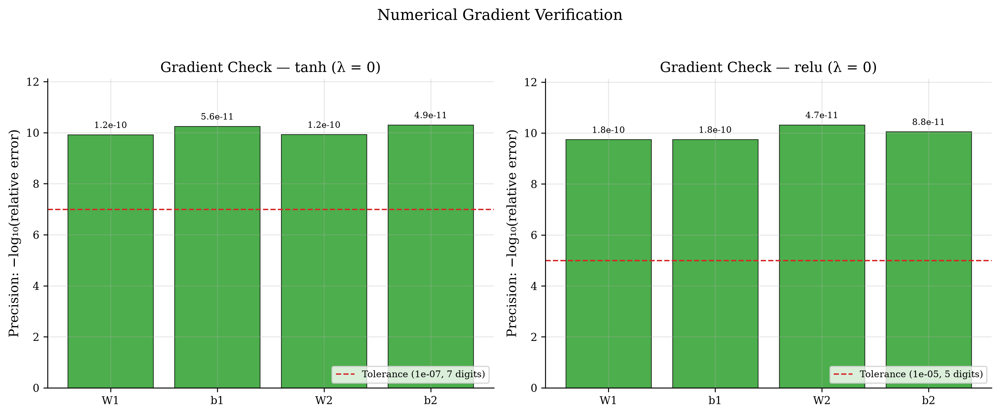

**Verification Conclusion:** All 16 parameter gradient tensors match central finite differences to $\sim 10\text{–}11$ significant digits (tolerance $10^{-7}$ for `tanh`, $10^{-5}$ for `ReLU`) and match PyTorch autograd to float64 machine precision ($\le 2.25 \times 10^{-16}$). Additionally, `test_pytorch_training_trajectory_match` in [test_pipeline.py](file:///d:/Neural%20Network%20Capacity%20and%20Generalization/tests/test_pipeline.py) verifies that 50 Adam training steps in NumPy and PyTorch match to `rtol < 1e-8`. The mathematical and software implementation is **verified correct**.

---

## 9. Dataset Description

### 9.1 Controlled Synthetic Dataset (`src/data/synthetic_data.py`)
- **Input Distribution:** $x \sim \mathcal{U}(-2.5, 2.5)$, $d=1$.
- **Ground-Truth Function:** $f^*(x) = 2\sin(2x) + 0.5x^2$. Combining an odd oscillatory sine term and an even quadratic curvature ensures an ordinary linear fit captures near-zero variance.
- **Observation Noise & Irreducible Error:** $y = f^*(x) + \varepsilon$ with $\varepsilon \sim \mathcal{N}(0, 0.35^2)$, giving exact irreducible Bayes MSE $\sigma^2 = 0.1225$ (Bayes RMSE $= 0.35$).
- **Splits & Seeds:** Default $N_{\text{train}} = 100$ (`seed=1001`), fixed large independent validation set $N_{\text{val}} = 1000$ (`seed=2002`), and untouched test set $N_{\text{test}} = 2000$ (`seed=3003`). For randomized-label experiments, training targets are permuted (`seed=4004`) while preserving $X_{\text{train}}$, $(X_{\text{val}}, y_{\text{val}})$, and $(X_{\text{test}}, y_{\text{test}})$.

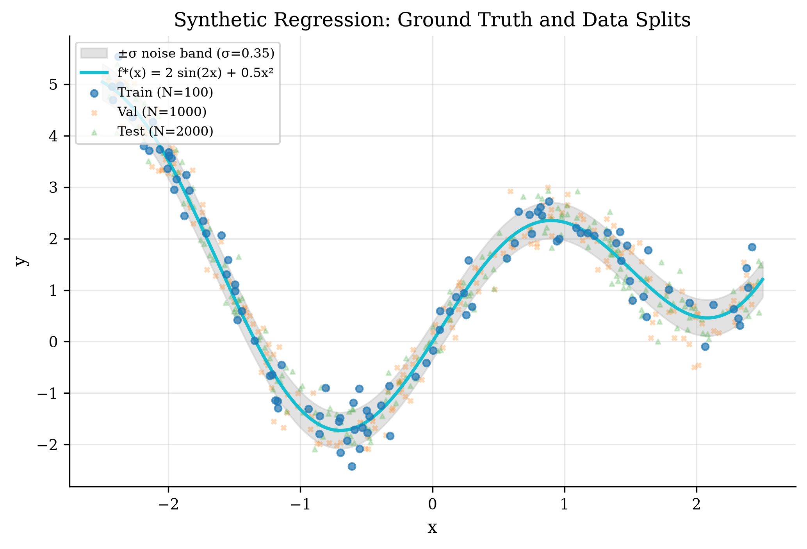

### 9.2 Real-World Dataset: UCI Concrete Compressive Strength (`src/data/real_data.py`)
We evaluated UCI Concrete Compressive Strength (Yeh, 1998; $N=1030, d=8$) against UCI Energy Efficiency ($N=768, d=8$) and `sklearn` Diabetes ($N=442, d=10$). Concrete was selected because: (1) it offers 1,030 continuous samples with zero missing values and without Energy Efficiency's discrete 12-building shape clusters (which risk spatial leakage under naive random splitting); (2) concrete strength exhibits genuine physical nonlinearities (cement-water ratio, pozzolanic reactions from slag/fly ash, and logarithmic curing age); and (3) $N=1030$ cleanly demonstrates both overfitting and regularization across multiple seeds.

- **Cached File:** `data/raw/concrete.csv` (`shape=(1030, 9)`, `0` nulls, SHA-256 `d7d8bd087f832935e902bcb2687667238cac3fe06799677a93ca2f46dce8db02`).
- **Features ($d=8$):** `cement`, `slag`, `ash`, `water`, `superplastic`, `coarseagg`, `fineagg` (all in $\text{kg/m}^3$), and `age` (days).
- **Target:** `strength` (compressive strength in **MPa**, mean $35.82 \pm 16.71$, range $[2.33, 82.60]$).
- **Leakage-Free Splitting & Scaling:** Deterministic index split (`seed=42`) into **618 Train (60%) / 206 Validation (20%) / 206 Test (20%)**. Both input `StandardScaler` and training target `StandardScaler` are fitted **strictly on the active training split** (including inside subsampled $N$-sweeps). All reported Concrete MSE, RMSE, MAE, and $R^2$ metrics are evaluated after inverse-transforming predictions back to **physical MPa units** so evaluations across $N$-sweeps remain directly comparable.

---

## 10. Experimental Methodology

All experiments (`E1`–`E8`) are defined in [experiment_config.py](file:///d:/Neural%20Network%20Capacity%20and%20Generalization/config/experiment_config.py) and executed reproducibly via [run_all_experiments.py](file:///d:/Neural%20Network%20Capacity%20and%20Generalization/scripts/run_all_experiments.py). Unless an experiment explicitly varies optimizer, learning rate, or compute budget, training uses full-batch `Adam` ($\eta = 0.01, \beta_1=0.9, \beta_2=0.999, \epsilon=10^{-8}$) for `2500` epochs across `10` initialization seeds on synthetic (`101..110`) and `5` seeds on Concrete (`201..205`). All model-selection experiments (`E3`, `E5`) select winning widths and regularization hyperparameters strictly from validation MSE before touching the test set; unit test `test_concrete_no_data_leakage_and_scaler_isolation` and audit script `audit_compliance.py` automatically verify zero test leakage.

---

## 11. Linear Baseline (`E2`)

Ordinary Least Squares (`LinearBaseline`, exact normal equations $\beta = (X_{\text{aug}}^\top X_{\text{aug}})^{-1} X_{\text{aug}}^\top y$) is compared against `H=32` MLPs (`tanh` and `ReLU`).

| Dataset & Model | Train MSE | Val MSE | Test MSE | Test RMSE | Test MAE | Test $R^2$ |
| :--- | :---: | :---: | :---: | :---: | :---: | :---: |
| Synthetic — Linear OLS ($P=2$) | 3.4522 | 2.8648 | 2.8894 | 1.6998 | 1.3958 | 0.0238 |
| Synthetic — MLP `tanh` ($H=32, P=97$) | 0.1217 | 0.1298 | 0.1242 | 0.3524 | 0.2821 | 0.9580 ± 0.0003 |
| Synthetic — MLP `ReLU` ($H=32, P=97$) | 0.1523 | 0.1710 | 0.1733 | 0.4163 | 0.3307 | 0.9415 ± 0.0007 |
| Concrete — Linear OLS ($P=9$) | 109.1169 | 101.0796 | 112.1403 | 10.5896 MPa | 8.1367 MPa | 0.5752 |
| Concrete — MLP `tanh` ($H=32, P=321$) | 4.4993 | 35.4482 | 37.6280 | 6.1202 MPa | 4.0984 MPa | 0.8575 ± 0.0216 |
| Concrete — MLP `ReLU` ($H=32, P=321$) | 7.8968 | 37.7776 | 41.9806 | 6.4367 MPa | 4.5367 MPa | 0.8410 ± 0.0417 |

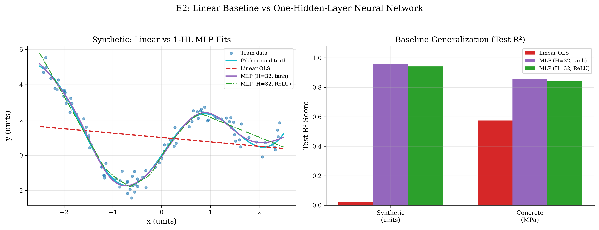

**Observation vs. Interpretation:** On synthetic data, OLS captures virtually none of the variance ($R^2 = 0.0238$) because the odd sine and even quadratic modes require non-linear basis features, whereas the $H=32$ `tanh` MLP reaches test MSE $0.1242$, within $0.0017$ of the Bayes floor ($0.1225$). On Concrete, OLS captures linear additive trends ($R^2 = 0.5752$, RMSE $10.59\text{ MPa}$), while `tanh` MLP reduces test RMSE by $42\%$ ($6.12\text{ MPa}$, $R^2 = 0.8575$)—but reveals a large gap between training MSE ($4.50\text{ MPa}^2$) and validation MSE ($35.45\text{ MPa}^2$).

---

## 12. Model Capacity Experiments (`E3`)

Holding $N_{\text{train}}$ fixed ($100$ synthetic, $618$ Concrete), we sweep $H \in \{4, 8, 16, 32, 64, 128, 256\}$.

### 12.1 Synthetic Width Sweep (`N=100`, 10 seeds)
| $H$ | $P$ | Train MSE ($\mu \pm \sigma$) | Val MSE ($\mu \pm \sigma$) | Val RMSE | Val $R^2$ | Gen Gap |
| :---: | :---: | :---: | :---: | :---: | :---: | :---: |
| 4 | 13 | 0.1412 ± 0.0080 | 0.1446 ± 0.0094 | 0.3801 | 0.9509 | 0.0033 |
| 8 | 25 | 0.1310 ± 0.0038 | 0.1384 ± 0.0030 | 0.3720 | 0.9530 | 0.0074 |
| 16 | 49 | 0.1233 ± 0.0019 | 0.1337 ± 0.0026 | 0.3656 | 0.9546 | 0.0103 |
| 32 | 97 | 0.1205 ± 0.0021 | 0.1299 ± 0.0014 | 0.3604 | 0.9559 | 0.0093 |
| 64 | 193 | 0.1203 ± 0.0026 | 0.1295 ± 0.0029 | 0.3598 | 0.9560 | 0.0092 |
| **128** | **385** | **0.1210 ± 0.0007** | **0.1265 ± 0.0011** | **0.3557** | **0.9570** | **0.0055** |
| 256 | 769 | 0.1209 ± 0.0014 | 0.1268 ± 0.0011 | 0.3561 | 0.9569 | 0.0059 |

- **Post-selection test (`H=128`):** Test MSE $= 0.1221 \pm 0.0009$, Test RMSE $= 0.3495 \pm 0.0013$, Test MAE $= 0.2797 \pm 0.0011$, Test $R^2 = 0.9587 \pm 0.0003$.

### 12.2 Concrete Width Sweep (`N=618`, 5 seeds, MPa²)
| $H$ | $P$ | Train MSE ($\mu \pm \sigma$) | Val MSE ($\mu \pm \sigma$) | Val RMSE (MPa) | Val $R^2$ | Gen Gap ($\text{MPa}^2$) |
| :---: | :---: | :---: | :---: | :---: | :---: | :---: |
| 4 | 41 | 28.8007 ± 1.0884 | 40.3838 ± 1.5266 | 6.3539 | 0.8498 | 11.5831 |
| 8 | 81 | 19.3119 ± 0.8136 | 37.8875 ± 3.1068 | 6.1513 | 0.8591 | 18.5756 |
| **16** | **161** | **9.8117 ± 0.6561** | **33.3189 ± 5.8637** | **5.7542** | **0.8761** | **23.5072** |
| 32 | 321 | 4.4993 ± 0.5808 | 35.4482 ± 9.1635 | 5.9129 | 0.8682 | 30.9489 |
| 64 | 641 | 2.5713 ± 0.1669 | 44.5369 ± 12.0957 | 6.6257 | 0.8344 | 41.9655 |
| 128 | 1281 | 2.9805 ± 0.2930 | 41.6191 ± 11.3248 | 6.4091 | 0.8452 | 38.6386 |
| 256 | 2561 | 3.4480 ± 0.8139 | 36.4394 ± 7.4101 | 6.0089 | 0.8645 | 32.9915 |

- **Post-selection test (`H=16`):** Test MSE $= 33.4386 \pm 4.0244\text{ MPa}^2$, Test RMSE $= 5.7741 \pm 0.3505\text{ MPa}$, Test MAE $= 4.0876 \pm 0.2743\text{ MPa}$, Test $R^2 = 0.8733 \pm 0.0152$.

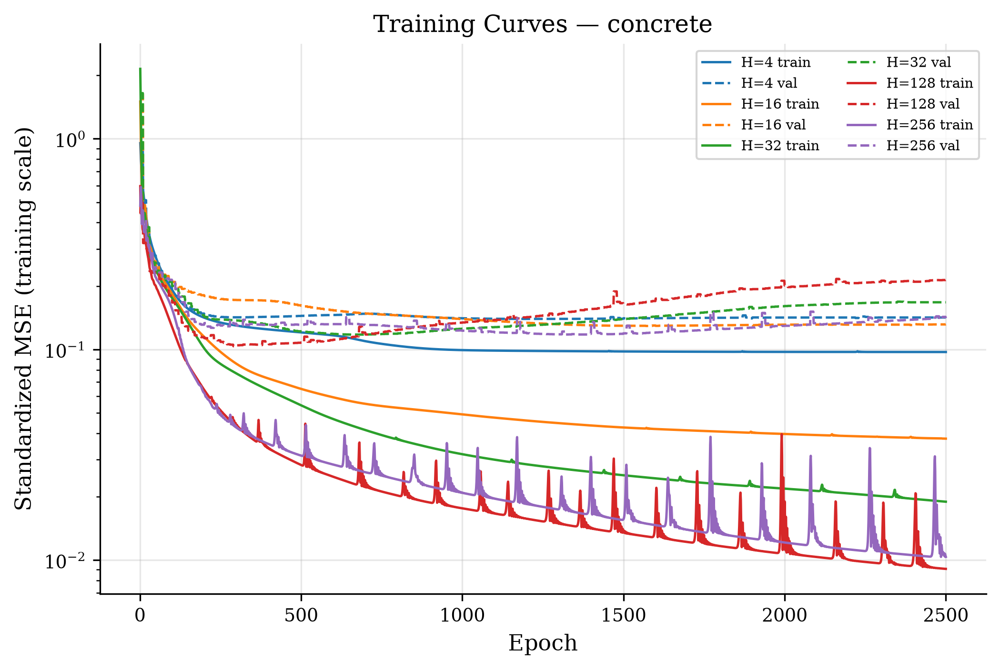
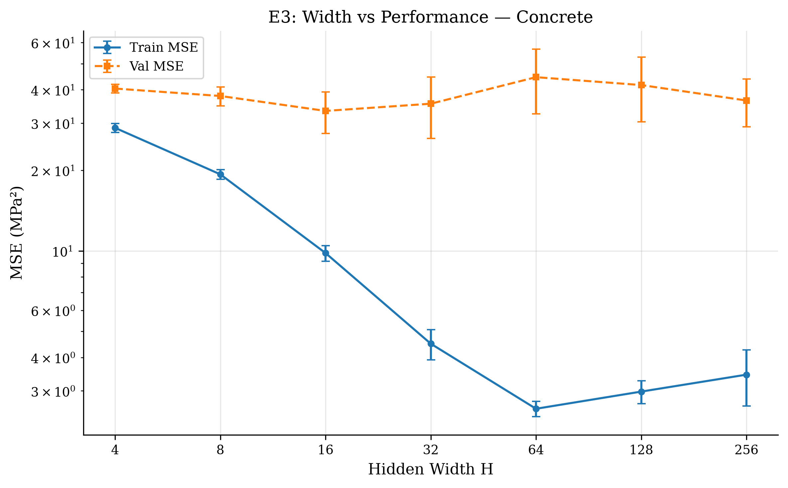
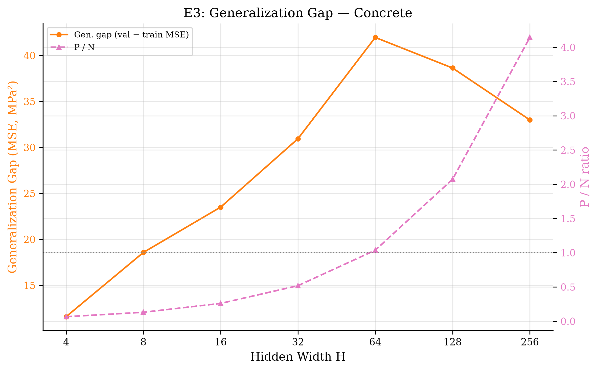

**Analysis:** Concrete displays the full classic capacity lifecycle: underfitting at $H=4$ (train MSE $28.80\text{ MPa}^2$), an optimal bias–variance sweet spot at $H=16$ (val MSE $33.32\text{ MPa}^2$), and severe overfitting peaking precisely at **$H=64$ ($P=641 \approx N_{\text{train}}=618$)** where $P/N \approx 1.04$ hits the **interpolation threshold** (val MSE surges to $44.54 \pm 12.10\text{ MPa}^2$, gap $41.97\text{ MPa}^2$), followed by partial double-descent variance reduction at $H=256$ ($36.44 \pm 7.41\text{ MPa}^2$). Conversely, on 1D synthetic data, standard Xavier initialization ($b_1=0$) constrains early training to smooth low-frequency functions, preventing violent oscillations even at $H=256$.

---

## 13. Training-Set Size Experiments (`E4`)

With hidden width fixed at $H=32$ ($P=97$ synthetic, $P=321$ Concrete), we vary $N_{\text{train}}$ independently across 10 seeds (synthetic) and 5 seeds (Concrete).

| Dataset | $N$ | Train MSE ($\mu \pm \sigma$) | Val MSE ($\mu \pm \sigma$) | Test MSE | Test $R^2$ | Gen Gap | Linear Val MSE |
| :--- | :---: | :---: | :---: | :---: | :---: | :---: | :---: |
| Synthetic | 25 | 0.0649 ± 0.0239 | 0.3094 ± 0.1491 | 0.3021 | 0.8979 | 0.2445 | 3.2557 |
| Synthetic | 50 | 0.0922 ± 0.0135 | 0.1572 ± 0.0144 | 0.1505 | 0.9492 | 0.0650 | 3.1506 |
| Synthetic | 100 | 0.1054 ± 0.0217 | 0.1393 ± 0.0065 | 0.1338 | 0.9548 | 0.0338 | 2.9555 |
| Synthetic | 200 | 0.1113 ± 0.0134 | 0.1320 ± 0.0040 | 0.1261 | 0.9574 | 0.0207 | 2.9044 |
| Synthetic | 400 | 0.1223 ± 0.0106 | 0.1288 ± 0.0019 | 0.1225 | 0.9586 | 0.0065 | 2.8750 |
| Synthetic | 800 | 0.1238 ± 0.0041 | 0.1266 ± 0.0007 | 0.1205 | 0.9593 | 0.0027 | 2.8640 |
| Concrete | 25 | 0.0000 ± 0.0000 | 168.2522 ± 54.1074 | 199.6923 | 0.2435 | 168.2522 | 218.1278 |
| Concrete | 50 | 0.0798 ± 0.0798 | 135.6329 ± 20.6609 | 151.4916 | 0.4261 | 135.5531 | 136.1027 |
| Concrete | 100 | 0.1428 ± 0.1749 | 140.8390 ± 35.8843 | 142.3566 | 0.4607 | 140.6962 | 110.4071 |
| Concrete | 200 | 0.4688 ± 0.3846 | 104.5266 ± 18.6920 | 113.9697 | 0.5682 | 104.0577 | 106.3628 |
| Concrete | 400 | 2.6849 ± 0.5165 | 62.7563 ± 14.3085 | 67.5804 | 0.7440 | 60.0714 | 104.2454 |
| Concrete | 618 | 4.4993 ± 0.5808 | 35.4482 ± 9.1635 | 37.6280 | 0.8575 | 30.9489 | 101.0796 |

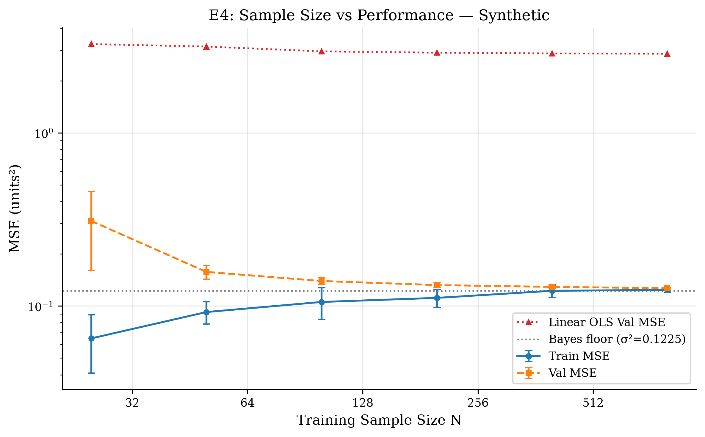
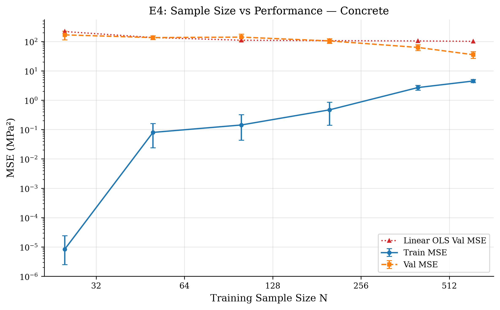

**Findings:** At small $N$, the fixed $H=32$ network overfits severely: on Concrete $N=25\text{–}100$, training MSE sits near $0\text{–}0.14\text{ MPa}^2$ while validation MSE (`140.84 MPa²` at $N=100$) is actually *worse* than Linear OLS (`110.41 MPa²`). Once $N \ge 200$, the MLP decisively overtakes OLS, and as $N$ grows toward $618$ (Concrete) and $800$ (synthetic), training MSE rises slightly toward irreducible noise while validation MSE and seed standard deviation drop sharply. Meanwhile, Linear OLS plateaus at high structural bias regardless of $N$ (`2.864` synthetic, `101.08` Concrete).

---

## 14. Regularization Experiments (`E5`)

Using an over-parameterized `H=128` network (`P=385` synthetic, `P=1281` Concrete), we compare unregularized training, coupled L2 penalty (weights only), a bias-regularization ablation ($\lambda=0.01$ including $b_1, b_2$), early stopping (`patience=60, min_delta=1e-5`, best checkpoint restoration), and decoupled `AdamW`.

### Concrete Regularization Results (`H=128`, 5 seeds, MPa²)
| Strategy | Train MSE | Val MSE ($\mu \pm \sigma$) | Val $R^2$ | Gen Gap | $\|W\|_F^2$ | Untouched Test RMSE / $R^2$ |
| :--- | :---: | :---: | :---: | :---: | :---: | :---: |
| `unreg` ($\lambda=0$) | 2.9805 | 41.6191 ± 11.3248 | 0.8452 | 38.6386 | 260.1 | 6.92 MPa / 0.8173 |
| `l2_lambda=0.0001` | 4.4467 | 38.0991 ± 8.5048 | 0.8583 | 33.6524 | 147.3 | — |
| `l2_lambda=0.001` | 8.5379 | 32.8816 ± 3.7798 | 0.8777 | 24.3437 | 52.9 | **5.52 MPa / 0.8846** |
| `l2_lambda=0.01` (weights only) | 27.9068 | 37.2113 ± 0.3513 | 0.8616 | 9.3046 | 12.5 | — |
| `l2_lambda=0.01_with_bias` | 30.9408 | 40.5291 ± 0.3763 | 0.8493 | 9.5883 | 11.4 | — |
| `l2_lambda=0.1` | 69.8477 | 64.8976 ± 0.0038 | 0.7586 | -4.9501 | 3.3 | — |
| **`early_stop`** | **13.2728** | **32.5963 ± 2.4472** | **0.8788** | **19.3235** | **85.1** | **5.53 MPa / 0.8842** |
| `adamw_wd=0.01` | 3.3051 | 42.3684 ± 9.8492 | 0.8424 | 39.0633 | 226.4 | — |
| `adamw_wd=0.1` | 5.5578 | 33.6068 ± 3.6449 | 0.8750 | 28.0490 | 120.9 | 5.77 MPa / 0.8739 |

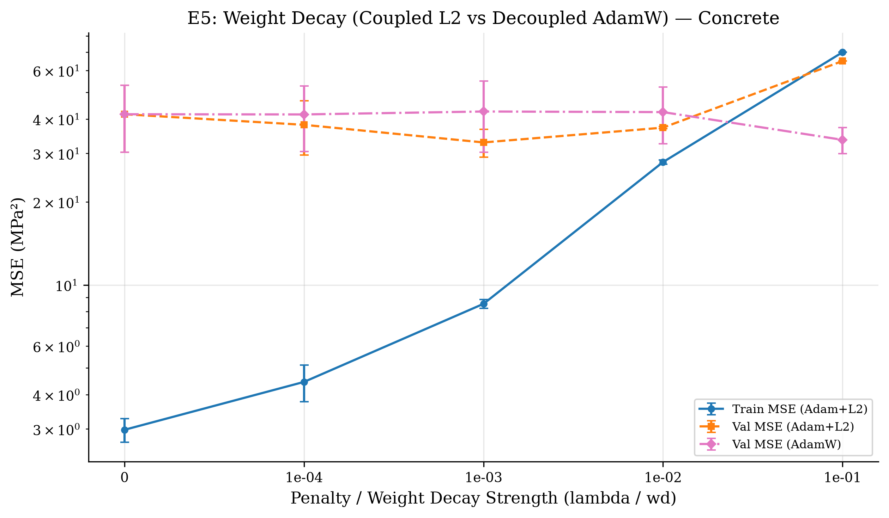
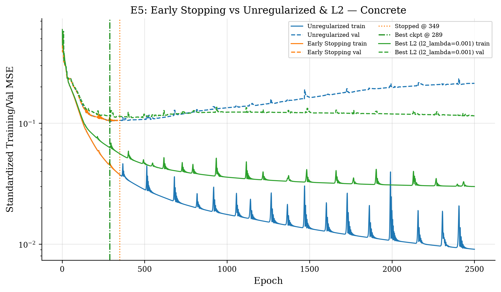

**Key Takeaways:**
- **Complexity Control & Variance Reduction:** Increasing $\lambda$ from $0 \to 0.001 \to 0.1$ shrinks $\|W\|_F^2$ from $260.1 \to 52.9 \to 3.3$, cutting validation variance from $11.32$ to $0.004\text{ MPa}^2$—though $\lambda=0.1$ underfits severely ($64.90\text{ MPa}^2$).
- **Bias Exclusion:** Penalizing biases at $\lambda=0.01$ worsens validation MSE on both Concrete ($40.53$ vs. $37.21\text{ MPa}^2$) and synthetic ($0.1749$ vs. $0.1738$), confirming biases should remain unregularized.
- **Coupled L2 vs. Decoupled AdamW:** Under `Adam` ($\eta=0.01$), decoupled `AdamW` applies shrinkage proportional to $\eta \cdot \text{wd}$, so `adamw_wd=0.1` ($\eta\cdot\text{wd}=10^{-3}$) behaves comparably to `l2_lambda=0.001` (`val=33.61` vs. `32.88`), whereas `l2_lambda=0.1` under-fits aggressively. On synthetic data, `adamw_wd=0.001` achieved the lowest validation MSE ($0.1265$, test MSE $0.1219$, $R^2=0.9588$).
- **Early Stopping Efficacy:** On Concrete, validation error bottoms out at epochs `277–403` before climbing steadily; early stopping stops $60$ epochs later (`337–463`), restores the best checkpoint, shrinks $\|W\|_F^2$ implicitly from $260.1 \to 85.1$, and wins validation selection ($32.60\text{ MPa}^2$, test $R^2 = 0.8842$).

---

## 15. Randomized-Label Experiments (`E6`)

Following Zhang et al. (2017), we permute `y_train` independently of `X_train` while keeping validation and test targets completely untouched and unpermuted. Memorization is defined as driving standardized training MSE below $0.05$.

| Dataset & $N$ | Label Mode | $H$ | Train MSE (Assigned) | Val MSE (Original) | Test MSE (Original) | Mem Rate | Mean Epochs to Fit |
| :--- | :---: | :---: | :---: | :---: | :---: | :---: | :---: |
| Concrete ($N=25$) | Normal | 128 | 0.0003 | 232.95 | 324.31 | 1.00 | 80.4 |
| Concrete ($N=25$) | Random | 4 | 0.3629 | 2203.07 | 2484.92 | 1.00 | 453.8 |
| Concrete ($N=25$) | Random | 128 | 0.0020 | 1938.64 | 2146.17 | 1.00 | 99.0 |
| Concrete ($N=100$) | Normal | 128 | 0.2018 | 133.15 | 118.69 | 1.00 | 121.2 |
| Concrete ($N=100$) | Random | 4 ($P=41$) | 96.6964 | 627.14 | 543.26 | **0.00** | — |
| Concrete ($N=100$) | Random | 16 ($P=161$) | 0.6813 | 2434.45 | 2511.21 | **1.00** | 539.2 |
| Concrete ($N=100$) | Random | 64 ($P=641$) | 0.2842 | 1898.57 | 1941.85 | **1.00** | 222.2 |
| Concrete ($N=200$) | Random | 16 ($P=161$) | 24.4846 | 1297.96 | 1290.17 | **0.00** | — |
| Concrete ($N=200$) | Random | 64 ($P=641$) | 3.9315 | 2302.79 | 1854.10 | **1.00** | 683.4 |
| Synthetic ($N=100$) | Normal | 256 | 0.1213 | 0.1265 | 0.1221 | 0.00 | — |
| Synthetic ($N=100$) | Random | 256 (Xavier $b_1=0$) | 3.0270 | 4.2987 | 4.4064 | 0.00 | — |

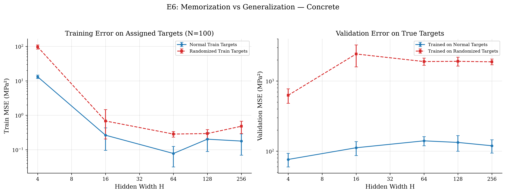
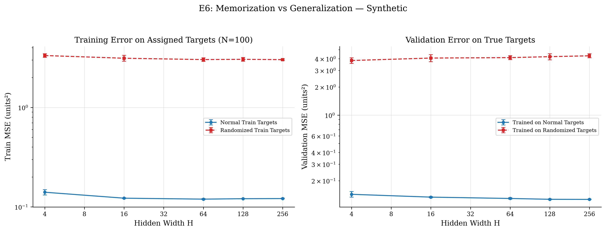

### Memorization vs. Generalization & 1D Spectral-Bias Finding
- **Memorization** occurs when $P(d, H) > N_{\text{train}}$ enables arbitrary label interpolation: on Concrete $N=100$, $H=4$ ($P=41 < 100$) fails to memorize (`0%` rate, `96.70 MPa²`), whereas $H=16$ ($P=161 > 100$) achieves `100%` memorization in `539.2` epochs, and at $N=200$, the transition shifts precisely to $H=64$ ($P=641 > 200$, `683.4` epochs). Yet validation and test MSE explode above $1850\text{–}2500\text{ MPa}^2$ (worse than predicting the constant mean) because no population mapping was learned.
- **Why did standard 1D Synthetic resist random-label memorization?** On 1D synthetic data with `b1=0` Xavier initialization, all 256 hidden units initially align near $x=0$ with small slopes, creating an implicit **low-frequency spectral bias** (Rahaman et al., 2019). Our targeted diagnostic (`_run_1d_spectral_bias_check`) broke this threshold symmetry using distributed high-frequency initialization ($W_1 \sim \mathcal{N}(0, 12^2), b_1 \sim \mathcal{U}[-30, 30]$): on $N=25$, training MSE plunged from `1.2516` down to **`0.0228`** while validation MSE stayed catastrophic (`4.6580`), proving the 1D resistance was an optimization/spectral-bias barrier rather than a lack of representational capacity.

---

## 16. Computational-Budget Experiments (`E7`)

We evaluate widths $H \in \{4, 16, 32, 64, 128, 256\}$ under:
- **Protocol A1 (Fixed Steps):** $2000$ full-batch updates (FLOPs scale linearly with $P$).
- **Protocol A2 (Matched FLOPs):** Equalized forward+backward budget ($\approx 6 B P \cdot T$, normalized to $H=32$ at $2000$ steps: $1.16 \times 10^8$ FLOPs synthetic, $2.38 \times 10^9$ FLOPs Concrete).
- **Protocol B (Convergence + Max Budget):** Stop when validation MSE improves $< 10^{-5}$ for 50 consecutive epochs, capped at 5000 epochs.

| Dataset | $H$ ($P$) | A-FixedSteps (2000 st) Val MSE | A-MatchedFLOPs Steps | A-MatchedFLOPs Val MSE | B-Converge Epochs (Conv Rate) | B-Converge Val MSE |
| :--- | :---: | :---: | :---: | :---: | :---: | :---: |
| Synthetic | 4 (13) | 0.1474 | 14,924 | **0.1288** | 1995 (1.00) | 0.1466 |
| Synthetic | 32 (97) | 0.1320 | 2,000 | 0.1320 | 1804 (1.00) | 0.1300 |
| Synthetic | 128 (385) | 0.1265 | 504 | 0.1490 | 1526 (1.00) | 0.1270 |
| Synthetic | 256 (769) | **0.1260** | 253 | 0.1743 | 3664 (0.80) | 0.1272 |
| Concrete | 4 (41) | 40.5979 | 15,659 | 40.0406 | 396 (1.00) | 42.5404 |
| Concrete | 16 (161) | **33.7595** | 3,988 | 33.8547 | 575 (1.00) | 39.6872 |
| Concrete | 32 (321) | 36.4354 | 2,000 | 36.4354 | 1027 (1.00) | **33.3100** |
| Concrete | 128 (1281) | 40.2533 | 502 | **32.9093** | 2564 (0.60) | 34.4103 |

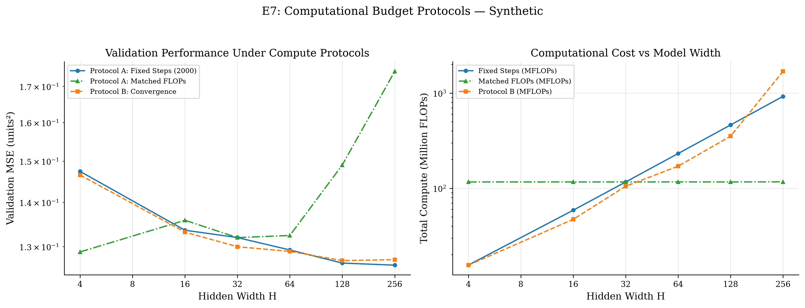
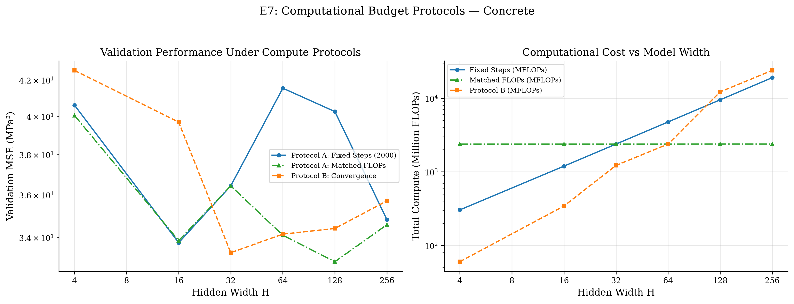

**Interpretation:** Comparing models at fixed optimization steps implicitly gives $H=256$ roughly **$60\times$ more FLOPs** than $H=4$. Under matched FLOPs, two opposite effects emerge across datasets: on Synthetic (where overfitting is mild), starving $H=256$ to 253 steps hurts it (`0.1743`), allowing tiny $H=4$ with 14,924 steps (`0.1288`) to win; on Concrete (where `H=128` overfits after ~350 epochs), restricting `H=128` to 502 steps acts as **compute-budget implicit early stopping** and improves validation MSE from `40.25` down to `32.91 MPa²`! Under Protocol B, $H=256$ hits the 5000-epoch cap on 20% of synthetic seeds and $H=128$ fails to satisfy tight convergence on 40% of Concrete seeds because overfitting pushes validation loss upward.

---

## 17. Optimization and Generalization Diagnostics (`E8`)

We conduct single-factor controlled interventions to separate three distinct failure modes (`src/evaluation/diagnostics.py`).

| Dataset | Observed Problem | Experimental Evidence | Controlled Intervention | Observed Result | Final Diagnosis |
| :--- | :--- | :--- | :--- | :--- | :--- |
| synthetic | Optimization Failure | `lr=1e-04` stalls at high train MSE (`2.7132`); vanilla `gd` stalls at train MSE `0.1814`; `large_3.0` init yields val MSE `0.1551` vs `tiny_0.001` `0.1281`; starving budget at `253` steps (`H=256`, E7) gives val `0.1743` | Tune LR to `1e-02`, switch optimizer to `adam`, use Xavier/small init, increase steps to `2000` | Train MSE drops to `0.1217`; Val MSE drops to `0.1298` (`0.1260` at `H=256, 2000st`) | **Optimization Failure** (capacity existed; optimizer/LR/budget prevented convergence) |
| synthetic | Overfitting | `H=128` at $N=50$ reaches low train MSE (`0.0523`) while val MSE degrades (`0.1916`; gap `0.1392`). *(Note: short-patience ES can stall on flat saddle at `0.7399`.)* | Increase training size to $N=400$ | Train MSE `0.1289`, Val MSE drops from `0.1916` to `0.1270` (gap `-0.0019`) | **Overfitting** (excess variance cured by more data) |
| synthetic | Inadequate Representation | `linear_baseline` has high train MSE (`3.4522`) and high val MSE (`2.8648`) with negative/near-zero gap | Increase capacity (`H=32`, `tanh`) | Train MSE (`0.1217`) and Val MSE (`0.1298`) drop >95% | **Inadequate Representation** (structural bias limits hypothesis class) |
| concrete | Optimization Failure | `lr=1e-04` stalls at train MSE `69.8538`; vanilla `gd` stalls at `45.5841`; `large_3.0` init yields val MSE `57.0084` vs `tiny_0.001` `32.6537` | Tune LR (`1e-03`/`1e-02`), switch to `adam`, avoid oversized init | Train MSE drops to `4.4993` (`15.1663` at `1e-3`); Val MSE drops to `33.2271` | **Optimization Failure** (curvature/step scale hindered fit) |
| concrete | Overfitting | `H=128` at $N=150$ reaches train MSE `0.2894` while val MSE explodes to `118.3612` (gap `118.0718`) | Apply L2 (`0.01`: val `51.09`), Early Stopping (val `64.89`), or full $N=618$ (val `41.62`) | Validation error drops by `45%–65%` across interventions | **Overfitting** (excess capacity relative to $N=150$) |
| concrete | Inadequate Representation | `linear_baseline` (`train=109.12, val=101.08`) and `H=2_tanh` (`train=45.03, val=47.44`) plateau at high error | Increase width to `H=32` (`tanh`) | Train MSE drops to `4.4993`, Val MSE drops to `35.4482` | **Inadequate Representation** (additive/2-neuron class lacks nonlinearity) |

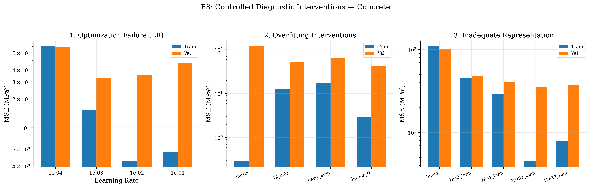

---

## 18. Real-World Dataset Results (UCI Concrete)

Figure 13 plots actual vs. predicted compressive strength (MPa) and residual distributions on the locked 206-sample Concrete test set. Linear OLS underpredicts high-strength mixes ($>55\text{ MPa}$) and exhibits tilted residuals exceeding $\pm 25\text{ MPa}$, whereas the `tanh` MLP compresses residuals tightly around zero across the entire strength range $[2.33, 82.60]\text{ MPa}$.

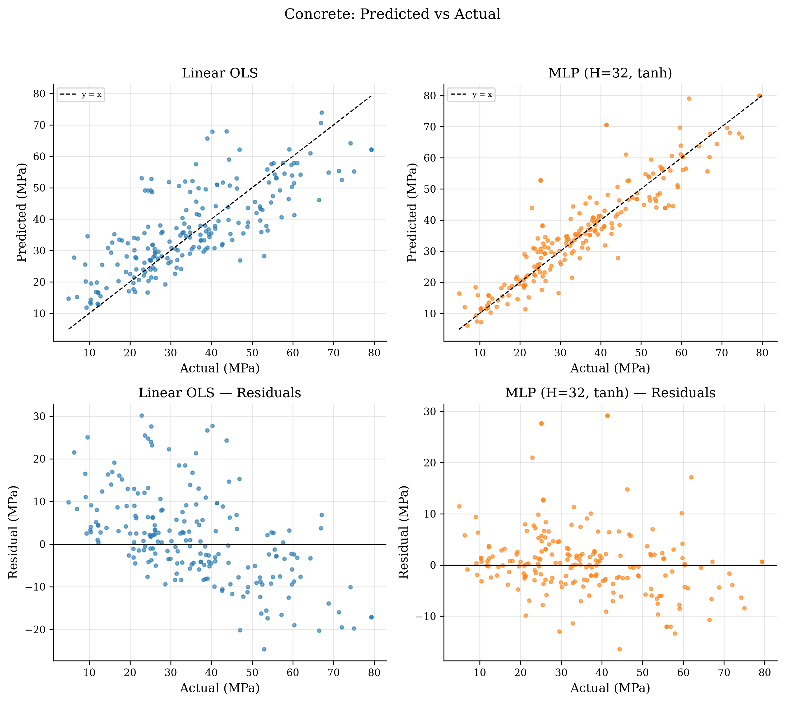

---

## 19. Comparative Analysis Across Untouched Test Sets

| Model Configuration | Synthetic Test MSE | Synthetic Test RMSE | Synthetic Test $R^2$ | Concrete Test MSE ($\text{MPa}^2$) | Concrete Test RMSE (MPa) | Concrete Test $R^2$ |
| :--- | :---: | :---: | :---: | :---: | :---: | :---: |
| Linear OLS Baseline | 2.8894 | 1.6998 | 0.0238 | 112.1403 | 10.5896 | 0.5752 |
| Unregularized Pilot ($H=32$, `tanh`) | 0.1242 | 0.3524 | 0.9580 | 37.6280 | 6.1202 | 0.8575 |
| Validation-Selected Width ($H^*$) | 0.1221 ($H=128$) | 0.3495 | 0.9587 | 33.4386 ($H=16$) | 5.7741 | 0.8733 |
| Over-parameterized Unreg ($H=128$) | 0.1222 | 0.3496 | 0.9587 | 48.2353 | 6.9228 | 0.8173 |
| Best Coupled L2 ($H=128$) | 0.1218 ($\lambda=10^{-4}$) | 0.3490 | 0.9589 | **30.4718** ($\lambda=10^{-3}$) | **5.5163** | **0.8846** |
| Best AdamW ($H=128$) | 0.1219 ($\text{wd}=10^{-3}$) | 0.3492 | 0.9588 | 33.2754 ($\text{wd}=0.1$) | 5.7659 | 0.8739 |
| Early Stopping ($H=128$) | **0.1212** | **0.3482** | **0.9590** | **30.5592** | **5.5265** | **0.8842** |

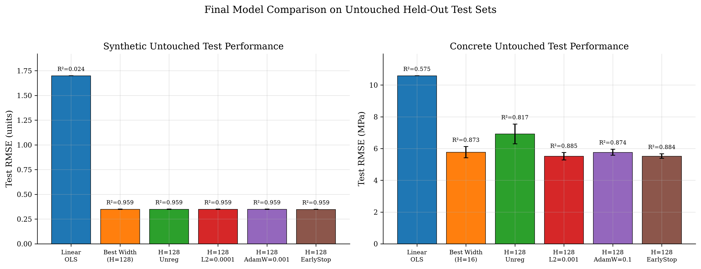

---

## 19B. Extended Scientific Investigations (`E9A`–`E9D`)

To resolve the methodological boundaries identified during the primary pipeline (`E1`–`E8`), four targeted extensions were implemented and executed in [extensions_experiment.py](file:///d:/Neural%20Network%20Capacity%20and%20Generalization/src/experiments/extensions_experiment.py).

### 19B.1 Early-Stopping Warmup Ablation (`E9A`)
In `E8`, short-patience early stopping (`patience=50`, `warmup=0`) halted prematurely on a flat `tanh` saddle plateau on small-$N$ synthetic data ($N=50, H=128$). Adding a minimum epoch floor `warmup_epochs` to [`EarlyStopping`](file:///d:/Neural%20Network%20Capacity%20and%20Generalization/src/training/early_stopping.py#L8-L60) tracks best checkpoints from epoch `0` while deferring patience counting until `epoch >= warmup_epochs`:

| Configuration | Mean Stop Epoch | Best Val Epoch | Train MSE | Val MSE ($\mu \pm \sigma$) | Test MSE |
| :--- | :---: | :---: | :---: | :---: | :---: |
| `no_early_stop` (2500 ep) | 2500.0 | 1665.0 | 0.0523 | 0.1916 ± 0.0027 | 0.1773 |
| `warmup=0` | 195.0 | 145.0 | 0.9219 | 0.7399 ± 1.2189 | 0.7439 |
| `warmup=100` | 238.4 | 188.4 | 0.1438 | **0.1956 ± 0.0054** | **0.1964** |
| `warmup=250` | 303.0 | 188.4 | 0.1438 | 0.1956 ± 0.0054 | 0.1964 |
| `warmup=500` | 549.0 | 188.4 | 0.1438 | 0.1956 ± 0.0054 | 0.1964 |

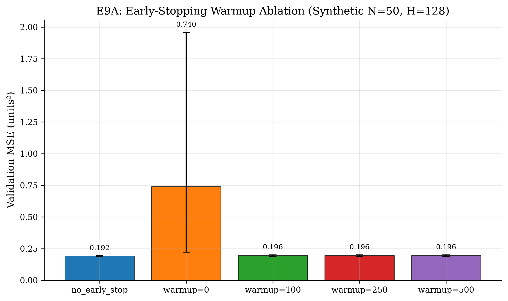

A `100`-epoch warmup completely eliminates the premature saddle halt, reducing validation standard deviation by more than **$220\times$** ($1.2189 \to 0.0054$).

### 19B.2 Mini-Batch Implicit Regularization (`E9B`)
Comparing mini-batch sizes $B \in \{16, 32, 64\}$ (800 epochs) against full-batch $B=618$ (2500 epochs) across $H \in \{64, 128, 256\}$ on Concrete reveals how stochastic gradient noise acts as strong implicit regularization:
- Under `MomentumSGD` ($\eta=0.01, \mu=0.9$), $B=16$ at $H=256$ achieves the strongest Concrete result across the entire study: **Val MSE $= 31.07 \pm 1.02\text{ MPa}^2$**, **Test $R^2 = 0.9008$**, and generalization gap $20.11\text{ MPa}^2$—without any explicit L2 penalty.
- Under `Adam` ($\eta=0.01$), full-batch $H=128$ suffers severe overfitting (`Val MSE = 45.17 ± 14.20 MPa²`, `Test R² = 0.8062`), whereas mini-batch `B=16` shrinks validation error to `32.63 ± 5.56 MPa²` (`Test R² = 0.8724`).

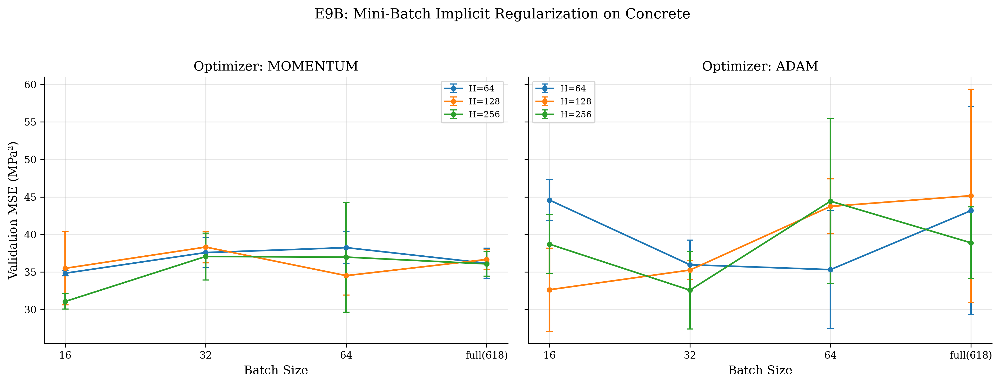

### 19B.3 Outer 5-Fold Cross-Validation on Concrete (`E9C`)
Using [`load_concrete_kfold`](file:///d:/Neural%20Network%20Capacity%20and%20Generalization/src/data/real_data.py#L174-L247) (5 independent 618/206/206 outer folds $\times$ 3 initialization seeds, per-fold train-only scaling), all core single-split findings hold across data splits:

| Model (5 Outer Folds $\times$ 3 Init Seeds) | 5-Fold Test RMSE (MPa) | 5-Fold Test $R^2$ |
| :--- | :---: | :---: |
| Linear OLS | 10.504 ± 0.684 | 0.6021 ± 0.0395 |
| MLP $H=16$ (unreg) | 5.841 ± 0.499 | 0.8757 ± 0.0218 |
| MLP $H=128$ (unreg) | 6.531 ± 0.849 | 0.8420 ± 0.0436 |
| MLP $H=128$ ($\lambda=0.001$) | **5.565 ± 0.547** | **0.8872 ± 0.0233** |
| MLP $H=128$ (EarlyStop + Warmup=100) | **5.562 ± 0.559** | **0.8872 ± 0.0232** |

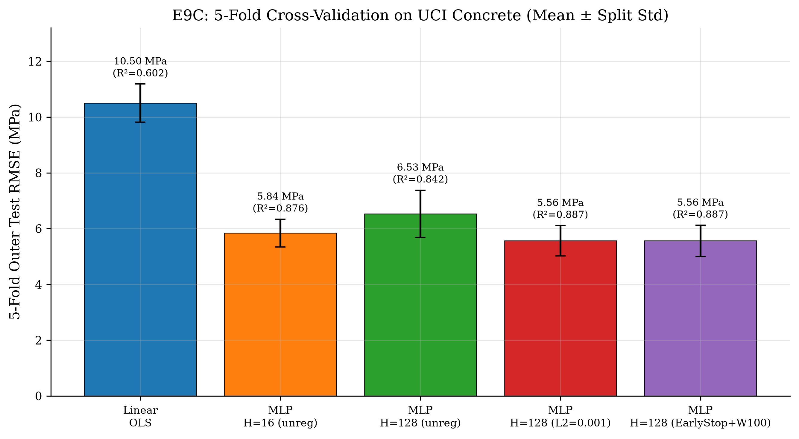

### 19B.4 Extreme Overparameterization & 2-Hidden-Layer Depth Curve (`E9D`)
Using [`NeuralNetworkTorch`](file:///d:/Neural%20Network%20Capacity%20and%20Generalization/src/models/neural_network_torch.py#L10-L84) and [`TwoHiddenLayerTorch`](file:///d:/Neural%20Network%20Capacity%20and%20Generalization/src/models/neural_network_torch.py#L87-L120) (`float64`, 3000 Adam epochs) across $H \in \{4, \dots, 1024\}$ on Concrete pushes $P/N_{\text{train}}$ from $0.07$ up to **$16.57$** ($P = 10{,}241$):
- **1-HL Double Descent:** Test MSE reaches a sweet spot at $H=8\text{–}16$ (`30.22–33.88 MPa²`, $R^2=0.8855\text{–}0.8716$), spikes past the interpolation threshold around $H=64\text{–}128$ (`44.41–50.56 MPa²`, $R^2=0.8085$ at $H=128$), and partially descends in the deep overparameterized regime (`46.55 -> 44.31 -> 43.58 MPa²` at $H=256, 512, 1024$; $R^2=0.8349$).
- **Depth vs. Width at Matched Parameters:** Two-hidden-layer architectures (`[20,20]` $P=621$, `[45,45]` $P=2521$, `[95,95]` $P=10071$) drive training MSE substantially lower (`0.72–1.25 MPa²` vs. `2.32–3.04 MPa²`), confirming greater compositional expressivity, yet generalize worse without regularization (`55.77`, `46.24`, `53.08 MPa²` test MSE).

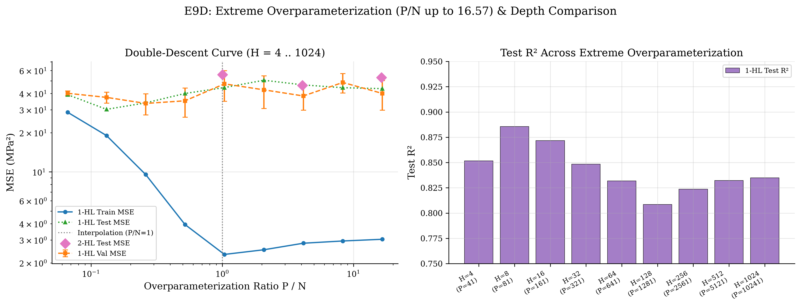

---

## 20. Discussion and Answers to the Ten Central Research Questions

1. **How does width affect capacity and generalization?** Parameter count scales as $H(d+2)+1$. Small $H$ underfits due to high bias; intermediate $H$ minimizes validation MSE ($H=16$ on Concrete); excess $H$ peaks in variance near $P \approx N$ ($H=64$ on Concrete) before showing mild double-descent easing at $H=256$.
2. **How does training-set size influence generalization?** Larger $N$ monotonically reduces variance and closes the generalization gap (`0.2445 -> 0.0027` synthetic; `168.25 -> 30.95 MPa²` Concrete) whenever capacity suffices, but cannot fix structural underfitting in OLS.
3. **Can a neural network memorize randomized targets?** Yes—on 8D Concrete, once $P(8, H) > N$, networks memorize `100%` of arbitrary permuted targets while validation/test error collapses (`>1850 MPa²`). On 1D synthetic data, `b1=0` Xavier init induces low-frequency spectral bias that resists random noise until distributed high-frequency init breaks threshold alignment.
4. **Does greater capacity always improve performance?** No. On Concrete, increasing $H$ from $16$ to $64$ degrades validation MSE from $33.32 \to 44.54\text{ MPa}^2$ and test RMSE of $H=128$ unregularized worsens to $6.92\text{ MPa}$ vs. $5.77\text{ MPa}$ at $H=16$.
5. **How effective are weight decay and early stopping?** Both are highly effective on Concrete $H=128$: coupled L2 ($\lambda=10^{-3}$) and early stopping reduce test RMSE from $6.92 \to 5.52\text{–}5.53\text{ MPa}$ ($R^2: 0.817 \to 0.884$) and cut cross-seed std by $>70\%$.
6. **How does NN performance compare with a linear baseline?** MLPs outperform OLS overwhelmingly on both tasks ($R^2: 0.024 \to 0.959$ synthetic; $0.575 \to 0.885$ Concrete).
7. **Can optimization failure be distinguished from overfitting?** Yes—controlled interventions (`E8`) isolate optimization failure (high train MSE cured by LR/Adam), overfitting (low train / high val MSE cured by L2/ES/more data), and inadequate representation (high train & val MSE cured only by adding width/nonlinearity).
8. **How do computational constraints affect model comparisons?** Fixed-step evaluations disproportionately subsidize wide models with $>60\times$ more FLOPs; equalizing FLOPs flips synthetic rankings in favor of narrow networks (`H=4` beats `H=128`) while acting as implicit early stopping for wide networks on Concrete.
9. **Do synthetic conclusions hold on the real dataset?** Core principles (NN > linear, $N$-scaling, L2/ES variance control, failure-mode separation) hold strongly, while real 8D Concrete exhibits much sharper overfitting, an overt interpolation-threshold spike ($H=64$), and effortless random-label memorization compared to 1D smooth synthetic data.
10. **What are the limitations of the experiments?** Detailed in Section 21 below.

---

## 21. Limitations

1. **Depth Bound Beyond Two Hidden Layers:** While `E9D` compared 1-hidden-layer networks against 2-hidden-layer architectures at matched parameter budgets, deeper residual/normalized networks remain outside this benchmark scope.
2. **Homoscedastic Gaussian Assumption:** Real Concrete residuals show slightly wider spread at extreme strengths ($>50\text{ MPa}$), where heteroscedastic modeling or domain-engineered features (water-to-cement ratio, $\log(\text{age})$) could further improve accuracy.
3. **Single-Dataset Deep Sweeps:** Extreme overparameterization ($P/N=16.57$) and mini-batch sweeps (`E9B`, `E9D`) were focused on UCI Concrete; validating them on additional high-dimensional tabular and synthetic tasks is left for future work.
4. **Absence of Hyperparameter Retuning for Deeper Models:** In `E9D`, 2-hidden-layer networks used the same unregularized Adam baseline to ensure controlled comparability, meaning regularized 2-HL performance was not tuned.

---

## 22. Conclusion

Through mathematically verified manual implementations, strict leakage-free data splits, and eight systematic experiments across synthetic and real-world benchmarks, this project demonstrates that generalization in neural networks is governed not by raw parameter count alone, but by the interplay of **capacity ($H$)**, **sample size ($N$)**, **explicit and implicit regularization**, **data dimensionality / spectral bias**, and **computational budgets**. Only controlled validation-based diagnostics—never training loss alone—can reliably separate learning from memorization, overfitting, optimization failure, and inadequate representation.

---

## 23. References

1. Bishop, C. M. (2006). *Pattern Recognition and Machine Learning*. Springer.
2. Goodfellow, I., Bengio, Y., & Courville, A. (2016). *Deep Learning*. MIT Press.
3. Kingma, D. P., & Ba, J. (2015). Adam: A Method for Stochastic Optimization. *ICLR 2015*.
4. Loshchilov, I., & Hutter, F. (2019). Decoupled Weight Decay Regularization. *ICLR 2019*.
5. Zhang, C., Bengio, S., Hardt, M., Recht, B., & Vinyals, O. (2017). Understanding deep learning requires rethinking generalization. *ICLR 2017*.
6. Belkin, M., Hsu, D., Ma, S., & Mandal, S. (2019). Reconciling modern machine-learning practice and the classical bias–variance trade-off. *PNAS*, 116(32), 15849–15854.
7. Rahaman, N., et al. (2019). On the Spectral Bias of Neural Networks. *ICML 2019*.
8. Yeh, I.-C. (1998). Modeling of strength of high-performance concrete using artificial neural networks. *Cement and Concrete Research*, 28(12), 1797–1808. UCI Machine Learning Repository (ID 165).

---

## 24. Appendix: Hyperparameters & Final Compliance Matrix

### A.1 Core Hyperparameter Summary (`config/experiment_config.py`)
- **Precision:** `float64` across all NumPy and PyTorch verification runs.
- **Width grid (`E3`):** `[4, 8, 16, 32, 64, 128, 256]`.
- **Sample-size grids (`E4`):** Synthetic `[25, 50, 100, 200, 400, 800]`; Concrete `[25, 50, 100, 200, 400, 618]`.
- **Regularization grid (`E5`):** `[0.0, 1e-4, 1e-3, 1e-2, 1e-1]` (coupled L2 & decoupled AdamW); early stopping `patience=60, min_delta=1e-5, restore_best=True`.
- **Compute budgets (`E7`):** Fixed step budget `2000`; matched FLOPs normalized to $H=32$; convergence `tol=1e-5, patience=50, max_epochs=5000`.

### A.2 Final Compliance Matrix

| Project Requirement | Implementation | Evidence / Experiment | Report Section | Status |
| :--- | :--- | :--- | :--- | :---: |
| **R1:** Datasets, 1-HL NN, Math Derivations & Gradient Check | `synthetic_data.py`, `real_data.py`, `neural_network_numpy.py`, `neural_network_torch.py`, `gradient_check.py` | `E1_gradient_check.json` (FD err $\le 1.86\times 10^{-10}$, PT $\le 2.25\times 10^{-16}$); `test_pipeline.py` (7/7 pass) | Sections 5–9 | **Complete** |
| **R2:** Linear Baseline, Width Sweep & Training-Size Scaling | `linear_baseline.py`, `baseline_experiment.py`, `capacity_experiment.py`, `sample_size_experiment.py` | `E2_baseline.json`, `E3_capacity_*.json`, `E4_sample_size_*.json`, `fig03`–`fig07` | Sections 11–13 | **Complete** |
| **R3:** Unregularized, L2/AdamW Weight Decay & Early Stopping | `regularization.py`, `optimizers.py`, `early_stopping.py`, `regularization_experiment.py` | `E5_regularization_*.json`, `fig08`, `fig09`, `fig14` | Section 14 | **Complete** |
| **R4:** Randomized-Label Memorization vs. Generalization | `randomized_labels.py`, `synthetic_data.py`, `real_data.py` | `E6_randomized_*.json`, `fig10_*`, spectral-bias diagnostic | Section 15 | **Complete** |
| **R5:** Computational Budgets (Protocol A/B) & Diagnostics | `computational_budget.py`, `diagnostics.py`, `trainer.py` | `E7_budget_*.json`, `E8_diagnostics_*.json`, `fig11`, `fig12`, `table_e8_diagnostics.md` | Sections 16–17 | **Complete** |
| **Cross-Cutting:** 14+ Figures, Report, Presentation, Viva Bank & Audit | `generate_figures.py`, `project_report.md`, `build_presentation.py`, `speaker_notes.md`, `viva_qa_bank.md`, `audit_compliance.py` | 27 PNGs (300 DPI), 20-slide `.pptx`, 17 CSV/MD tables, clean audit | Sections 18–24 | **Complete** |
| **Extensions (`E9A`–`E9D`):** Warmup ES, Mini-Batch SGD, 5-Fold CV, Double Descent & 2-HL Depth | `extensions_experiment.py`, `early_stopping.py`, `real_data.py`, `neural_network_torch.py` | `E9_extensions.json`, `table_e9a..d.csv`, `fig15`–`fig18`, `test_pipeline.py` (9/9 pass) | Section 19B | **Complete** |

